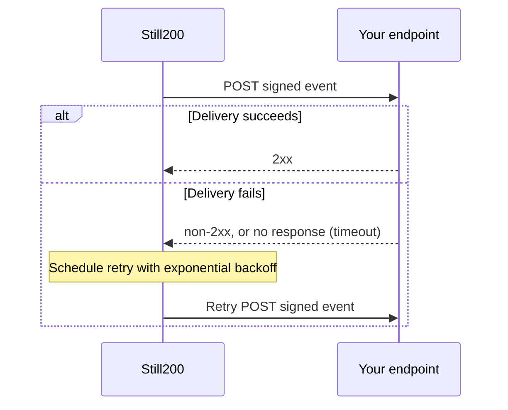

Webhooks let Still200 notify your application when an incident starts or resolves. Use them to trigger internal automation, update an external status system, or forward incidents to another alerting platform.

## Create an endpoint

<Steps>
  <Step title="Open Webhooks">
    Open **Webhooks** in [Still200](https://app.still200.com/settings/webhooks).
  </Step>
  <Step title="Enter the destination">
    Add a publicly reachable HTTPS URL.
  </Step>
  <Step title="Enter a description">
    Something to quickly help you remember what this webhook is for.
  </Step>
  <Step title="Select events">
    Select events you wish to receive webhooks for.
  </Step>
  <Step title="Store the signing secret">
    Copy the generated secret into your application's secret store. Signing secrets begin with `s200_whsec_` and are shown when the endpoint is created or rotated.
  </Step>
  <Step title="Send a test event">
    Send a test delivery, verify its signature, and confirm your endpoint returns a `2xx` response.
  </Step>
</Steps>

<Warning>
  Do not log or expose the signing secret. Rotating it invalidates the previous secret for new deliveries.
</Warning>

## Requirements

Your destination must:

- Use HTTPS and be publicly reachable.
- Accept `POST` requests containing JSON.
- Return a `2xx` response within ten seconds.
- Verify the request signature before processing the payload.
- Handle duplicate events safely by using the event `id` as an idempotency key.

<CardGroup cols={2}>
  <Card title="Event payloads" icon="brackets-curly" href="/webhooks/events" />
  <Card title="Verify signatures" icon="shield-check" href="/webhooks/signatures" />
</CardGroup>
